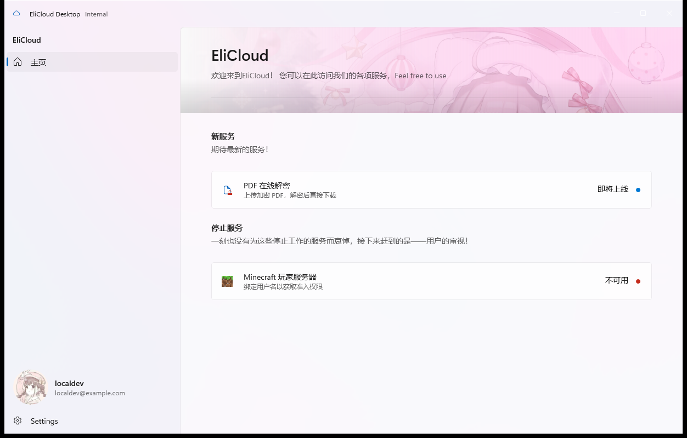

# EliCloud 桌面客户端

用 **WinUI-Reactor**（纯 C# 声明式 UI，工程内无任何 XAML）构建的 EliCloud 平台桌面客户端，
业务全部走官方 NuGet 包 **`EliCloud.Sdk`**（本版本 `1.0.0-alpha.3`）。界面按 `EliCloudDesktopUI.fig` 设计稿 1:1 还原。

> 个人资料页可编辑昵称、简介、头像与 banner 头栏图；头像与头图都用 CommunityToolkit 的
> `ImageCropper` 裁切（头像 1:1 圆形选区、头图按页头横幅 5:1），再分别缩到 512 / 1600 像素内的 PNG 上传。
> 页头横幅的高度随窗口宽度按 5:1 等比缩放，裁切弹窗里的取景与页头显示一致；
> 压在横幅上的标题卡片按内容收缩，最长到页面 56px 的页边距处。
> 头像/头图由 `userinfo` 代理 `file` 服务保存（固定 public + 永久），客户端不直连 file，
> 也不在本地落盘图片字节。
> 新账号的昵称默认为用户名；昵称不合法时「保存」直接不可用，不会在提交后再弹校验提示。



---

## 1. 快速开始

需要 .NET 10 SDK 与 Windows 开发者模式（packaged 应用要以调试标识注册运行）。

`local-dev/` 是独立仓库 [`EliCloudOrg/devtools`](https://github.com/EliCloudOrg/devtools)
的 submodule，拉代码时要一起初始化：

```powershell
git clone --recursive https://github.com/EliCloudOrg/EliCloudDesktop.git
# 已经 clone 过、local-dev 还是空目录：
git submodule update --init --recursive
```

### 两套开发构建方式

| 配置 | 连哪 | 什么时候用 |
|---|---|---|
| **`Debug-Prod`** | 远程平台（默认） | 日常开发、对照线上行为 |
| **`Debug-Local`** | 本机起的服务端 `http://127.0.0.1:8080` | 不想碰生产、要随手开号、要做破坏性验证 |
| `Debug` | 等同 `Debug-Prod` | 保留，让不带 `-c` 的构建与 IDE 默认配置照旧可用 |
| `Release` | 远程平台 | 发布 |

```powershell
# 连远程（默认）
dotnet run --project src\EliCloudDesktop\EliCloudDesktop.csproj -c Debug-Prod -p:Platform=x64

# 连本地：先把本地服务端起起来，再跑（源码版在 local-dev/）
local-dev\dev.ps1 up -Background
dotnet run --project src\EliCloudDesktop\EliCloudDesktop.csproj -c Debug-Local -p:Platform=x64

# 并列的 EliCloud.Sdk 仓库存在时，默认自动走 ProjectReference；
# SDK 在别处时显式指定：
dotnet build src\EliCloudDesktop\EliCloudDesktop.csproj -c Debug-Local -p:Platform=x64 `
  -p:EliCloudSdkProject=D:\path\to\EliCloud.Sdk\src\EliCloud.Sdk\EliCloud.Sdk.csproj
```

本地服务端怎么起、为什么还要一层 `/auth` 映射、本地缺哪些服务，见
[local-dev/README.md](local-dev/README.md)。源码方式会同时启动
**SSO + email + file + userinfo + mc**（mc 配内置假 RCON）；`docker compose` 方式
仍是本目录 `local-dev/` 下的 4 服务容器版，适合需要环境一致的场景。
`tools\start-local-server.ps1` 现在只是转到 `local-dev\dev.py` 的兼容壳，旧命令继续可用；
注册确认链接写在 `local-dev\.data\logs\email.log`，也可跑
`tools\ui-register-smoke.ps1` 做完整冒烟。

升级联调框架：在 `local-dev` 里 `git pull`（或切到新 tag），回到仓库根
`git add local-dev && git commit`，把新的 pin 提交上来。

### 平台入口地址是构建时注入的

两个配置的差别**只有这一个值**：`Debug-Local` 写 `http://127.0.0.1:8080`，
其余写远程入口。想临时打到别的环境就显式覆盖（显式传入优先）：

```powershell
dotnet build src\EliCloudDesktop\EliCloudDesktop.csproj -p:Platform=x64 `
  -p:EliCloudPlatformBaseAddress=https://your-entry
```

这个值被写进程序集元数据，客户端**不读环境变量、不读配置文件、界面上也不显示**：
它是我方基础设施，不是用户设置（见 §4）。所以客户端里**没有任何「本地专用」分支** ——
本地与线上对客户端呈现的接口面逐字一致。

本机配置落在 `%LOCALAPPDATA%\EliCloud\settings.json`，只存**上次用户名与界面主题** ——
不存入口地址、不存密码、不存 access token、不存 refresh token（原因见 §4）。

---

## 2. 工程结构

```text
EliCloudDesktop/
├── docs/
│   ├── design-spec.md          从 .fig 反解出来的设计规格（字号/间距/文案/令牌映射）
│   ├── reactor-feasibility.md  技术选型：哪里用 Reactor、哪里借官方控件、哪里走逃生舱
│   ├── copy-style.md           文案风格（ToC）与本次改写的对照表
│   └── screenshots/            实机截图，与设计稿逐屏比对用
├── local-dev/                  submodule → EliCloudOrg/devtools（五服务联调 + 容器版）
├── tools/
│   ├── start-local-server.ps1  兼容壳：转到 local-dev/dev.ps1
│   ├── local-account.ps1       在本地服务端建号 / 改密码 / 列账号
│   ├── ui-login-smoke.ps1      UI 自动化走一遍真实登录（冒烟）
│   ├── capture-window.ps1      按窗口标题截图（设计走查）
│   ├── fig/                    .fig 反解脚本（本目录的规格就是它们读出来的）
│   └── generate-icons.py       生成设计稿里没有的两张图标
└── src/EliCloudDesktop/
    ├── App.cs                  入口 + 根组件（窗口标题栏、状态、网关、登录/未登录切换、主题）
    ├── Core/                   路由、会话、全局状态、服务清单、状态模型、设置、错误文案
    ├── Services/
    │   └── EliCloudGateway.cs  EliCloud.Sdk 的唯一封装（登录/注册/userinfo/探活/MC 业务）
    ├── Shell/
    │   ├── MainShell.cs        NavigationView + 页面宿主（标题栏归 App 统一托管）
    │   └── NavFooterProfileItem.cs  FooterMenuItems 逃生舱（个人资料入口）
    ├── Pages/                  LoginPage / HomePage / ProfilePage / McServicePage / SettingsPage
    ├── Ui/                     DesignTokens（设计标尺）+ Widgets（Hero、分组表头、SettingCard、Badge）
    └── Assets/Images/          语义化命名的图片资源（见其 README）
```

---

## 3. 三页 + 两页 + 注册完成截图

| 页面 | 来源 | 截图 |
|---|---|---|
| 登录页 | 设计稿第 1 屏 | [01-login.png](docs/screenshots/01-login.png) |
| 主页 | 设计稿第 2 屏 | [02-home.png](docs/screenshots/02-home.png) |
| 个人资料页 | 设计稿第 3 屏 | [03-profile.png](docs/screenshots/03-profile.png) |
| MC 服务页 | **自行设计**（设计稿未画） | [04-mc-service.png](docs/screenshots/04-mc-service.png) |
| 设置页 | 对应 Nav 页脚的「设置」项 | [05-settings.png](docs/screenshots/05-settings.png) |
| 注册完成（验证后自动登录） | 邮箱验证流程的实机结果 | [06-register-verified.png](docs/screenshots/06-register-verified.png) |

> 截图除 MC 服务页外，都是 `-c Debug-Local` 连本机服务端、用真实账号登录后的实机画面
> （登录页为未登录态；06 是注册 → 邮箱确认 → 自动登录后的主界面）。
> MC 服务页需要真的 Minecraft 服务器（RCON）才有正向数据，
> 本地环境没有，所以那张是连远程时的画面。

设计稿的逐项还原依据（含每一个文案、字号、内边距的出处）见
[docs/design-spec.md](docs/design-spec.md)；界面文案的写法见
[docs/copy-style.md](docs/copy-style.md)。

**界面组件**：绝大部分是 Reactor 原生元素（`Border` / `Grid` / `Flex` / `TextBlock` / `Image`…），
设置类条目用 **Windows Community Toolkit 的 `SettingsCard`**，通过 Reactor 的
`[GenerateReactorWrapper]` 源生成器包成声明式元素 —— 所以工程里**没有任何 `.xaml` 文件**。
选型理由见 [docs/reactor-feasibility.md](docs/reactor-feasibility.md)。

---

## 4. 几个刻意的取舍

**入口地址是构建时常量，运行时不可改。**
两套开发配置（`Debug-Prod` / `Debug-Local`）只差 `EliCloudPlatformBaseAddress` 这一个值；
csproj 的 `GeneratePlatformConfig` 目标把它生成成**编译期常量**（Release 开过 `PublishTrimmed`，
常量对裁剪免疫），同时留一份程序集元数据以便从产物看出这份 DLL 是为哪个入口构建的。
没有设置项、不读环境变量、不读配置文件、界面上也不显示：它是我方基础设施，不是用户偏好。
值不合法时直接抛异常（构建配置错误要在开发/CI 阶段就炸，而不是等用户点了登录）。

**登录标识是「用户名或邮箱」，注册标识只能是「用户名」。**
服务端 `/v1/login` 的 `username` 字段（线上契约不能改名）收的其实是**登录标识**：
`app\authentication.py::find_user_by_identifier` 先按用户名、再按邮箱做大小写不敏感匹配。
注册时的用户名仍然只能是用户名（`validate_username` 的字符集不含 `@`），两种标识不会互相冒充。
所以客户端的登录态字段标签是 `用户名或邮箱`，而**注册模式**下收窄为 `用户名` 并加一行说明 ——
这两处的宽窄不同，是最容易做成「说了做不到」的地方。

> 这一条**依赖服务端的改动**（SSO 仓库 `app/authentication.py` + OIDC 登录页模板），
> 不是客户端单独能兑现的能力。

**注册必须先完成邮箱验证。**
「创建账号」提交后，客户端调用 `POST /auth/register` 拿到 `202 {registration_id,...}`，
进入 `VerifyEmailPage` 轮询 `/auth/register/status`；用户点击邮件里的确认链接后，
email 服务 HMAC 回调 SSO，SSO 创建账号，页面用内存中的密码自动登录。
密码只存在于登录组件与验证页 props 中，不写设置文件、不进日志。
相关组件：`Pages/LoginPage.cs`、`Pages/VerifyEmailPage.cs`、`Services/EliCloudGateway.cs`。

**登录成功后一定再拉一次 `/userinfo`。**
`/login` 响应里的 `user` 只是便利字段（账号没登记邮箱时就是 `null`），
而 `/userinfo` 才是按令牌作用域返回身份的权威来源 —— 设备码 / 授权码 + PKCE 这些
桌面端推荐流程里，令牌响应**根本没有** `user`，那时它是唯一的身份来源。
因此显示用的用户名/邮箱一律以 `/userinfo` 为准；补全失败也不会让登录作废（令牌已经到手）。

**用实例 API，不用 SDK 的静态门面。**
`EliCloudService.Configure(...)` 是进程级单例配置，且会诱导把「连哪」做成运行时可变的东西。
`EliCloudGateway` 用 `SsoClient` / `McClient` + `EliCloudOptions` 的实例用法，
入口地址来自构建时常量，进程里只有一个网关实例。

**不落盘任何凭据。**
SDK README §5.2 写得很清楚：密码直连签发的 refresh token 没有会话绑定，标准 `/logout`
找不到它，平台也已删掉私有的 `/v1/logout` —— 也就是说**签出去就撤不回来**。
把它写进磁盘等于换一种方式长期留存凭据。v1 只在内存里保留会话，重启需要重新登录。

**入口地址不外泄。**
界面上任何地方都不显示它（登录页原来那行「平台入口：https://…」已移除）。
出错只说「连不上服务器」；网关里连异常消息都不落进数据里，
因为 `HttpRequestException.Message` 通常带着主机名和端口。

**默认跟随系统主题。**
不指定元素级主题，浅色/深色随 Windows 的亮暗设置走；设置页可以固定成浅色或深色。

---

## 5. 服务状态：当前只有「可用 / 不可用」

主页每一张服务卡片右侧都有一个状态徽标，Nav 里的服务条目也按状态增删：

- **可用 / 不可用**是**真实探测**出来的：对服务健康接口做一次检查。
  服务在跑但写通道挂了 → 服务端返回 503 但响应体完整（SDK 照样解析成对象），
  我们据此判为「不可用」，但界面只对用户说「暂时不可用」。
- **即将上线 / 维护中 / 未知**是**预留状态**：模型、文案、颜色都已经就位，
  但当前没有任何接口能判定它们，所以不会凭空出现。
  （`pdf-decrypt` 在平台服务清单里已登记、实现尚未开始，因此声明为「即将上线」。）
- 主页的每个分组表头**当前状态下一个服务都没有时整组不渲染**。

---

## 6. 构建校验

```powershell
# 四个配置都要能过（Release 会顺带产 .msixpkg，证书密码的给法见 §7）
dotnet build EliCloudDesktop.slnx -c Debug-Prod  -p:Platform=x64 -v:m
dotnet build EliCloudDesktop.slnx -c Debug-Local -p:Platform=x64 -v:m
dotnet build EliCloudDesktop.slnx -c Debug       -p:Platform=x64 -v:m
dotnet build EliCloudDesktop.slnx -c Release     -p:Platform=x64 -v:m
```

> 本机没有 `certs\local.props` 时，最后那条要加 `-p:MsixDevCertPassword=<Password>`，
> 否则 MSIX 签名会失败（现象与原因见 §7「证书密码从哪来」）。

当前状态：三套开发配置 **0 error / 0 warning**（Reactor 分析器 `REACTOR_*` 全开且全部通过，
`-p:TreatWarningsAsErrors=true` 也是干净的）。

> **Release 比另外三套多 3 条打包侧的非致命告警**，因为它多做了一步「产 MSIX + 打容器」（§7）：
> `APPX0105` / `APPX0107`（打包工具往个人证书存储导入私钥失败；但 `signtool` 的签名仍然完成，
> 内层 `.msix` 里 `AppxSignature.p7x` 确实存在，容器 `verify` 也是 `result valid`），
> 以及一条没有错误码的 `mspdbcmf.exe` 缺失告警（本机不出符号包）。它们不是代码问题，
> 也没有让构建失败；三套开发配置的 0/0 不受影响。

如果本机装有 Reactor 的 `mur` CLI，等价命令是：

```powershell
mur check src\EliCloudDesktop\EliCloudDesktop.csproj --final
```

---

## 7. 打包成 .msixpkg（发布分发）

发布配置接了 [Msixpkg.Build](https://www.nuget.org/packages/Msixpkg.Build/0.1.0) 的 MSBuild 任务，
所以 **一次 `dotnet build -c Release` 就直接产出已签名的 `.msixpkg`**。用户拿到
`EliCloudDesktop_1.0.0.0_x64.msixpkg` 用 msixpkg 安装器 `install` 即可 —— 容器自带发布者证书，
安装器提权后把它写进 `LocalMachine\TrustedPeople`，用户不需要手工导入证书。

```powershell
# 1) 证书只在第一次（以及轮换时）生成。密码自己定，绝不写进仓库。
#    --manifest 让证书 Subject 自动等于清单里的 Identity/@Publisher。
winapp cert generate --manifest src\EliCloudDesktop\Package.appxmanifest `
  --output src\EliCloudDesktop\certs\App.Dev.pfx `
  --password <Password> --valid-days 3650 --export-cer

# 2) Restore 与 Build 必须分两次调用：包里的 build\Msixpkg.Build.targets 是经
#    obj\*.nuget.g.targets 在「求值阶段」导入的，而那个文件由 Restore 生成；
#    同一次 /t:Restore,Rebuild 来不及导入它，表现就是「构建成功但没有 .msixpkg」。
dotnet restore src\EliCloudDesktop\EliCloudDesktop.csproj
dotnet build   src\EliCloudDesktop\EliCloudDesktop.csproj -c Release --no-restore `
  -p:Platform=x64 -p:MsixDevCertPassword=<Password>
```

产物在 `src\EliCloudDesktop\artifacts\msix\EliCloudDesktop_<版本>_x64.msixpkg`（约 113 MB）。

### 证书密码从哪来（在 Visual Studio 里构建必看）

MSIX 签名要读 `.pfx`，所以要密码；密码又不准入库，所以它只能在构建时注入。按优先级三种来源：

| 来源 | 用在什么时候 |
|---|---|
| `-p:MsixDevCertPassword=<Password>` | CI、脚本、一次性构建 |
| `src\EliCloudDesktop\certs\local.props`（本机文件，`certs/` 在 `.gitignore` 里） | **在 Visual Studio 里构建 / F5 只能靠这条** —— VS 传不了 `-p:` |
| 环境变量 `MSIXPKG_DEV_CERT_PASSWORD` | 想在命令行与 VS 之间共用一个值 |

`certs\local.props` 的内容就这么点（本机已建好，换密码时同步改它）：

```xml
<Project>
  <PropertyGroup>
    <MsixDevCertPassword>你的密码</MsixDevCertPassword>
  </PropertyGroup>
</Project>
```

**不要指望「不给密码就不签名」。** `AppxPackageSigningEnabled=true` 时缺密码会让 MSIX 签名任务
直接失败 —— 在 `_GenerateAppxPackageFile` 里 `APPX0105` / `APPX0107` 是 **error** 而不是 warning，
现象是「`.msix` 都产出来了，构建却失败，也没有 `.msixpkg`」，光看报错完全看不出缺什么。
所以 csproj 里加了 `EliCloudCheckSigningCertificate` 目标：产包前先把「缺证书」与「缺密码」
分开报清楚，并直接告诉你三种补法。

### 三条必须同时成立的约束

| 约束 | 本工程的值 |
|---|---|
| 证书 Subject 与清单 `Identity/@Publisher` **逐字符相等**（`O=`/`C=` 的顺序与空格都算） | 两边都是 `CN=Elipese` |
| 容器四重身份一致：容器签名者 == `publisher.cer` == 内层 `.msix` 的 `AppxSignature.p7x` 签名者 == Appx 清单 `Publisher` | 同一次构建、同一张 `certs\App.Dev.pfx` 产生，天然一致 |
| 容器会把 `publisher.cer` 写进本机 `LocalMachine\TrustedPeople`（**永不写 `Root`**） | 自签证书只用于内部分发；公网分发换受信 CA 后设 `MsixpkgIncludeCertificate=false` |

### 几个刻意的取舍

- **密码绝不入库**：密码只会出现在三类位置之一 —— 命令行 `-p:MsixDevCertPassword=…`、
  本机 `certs\local.props`、环境变量 `MSIXPKG_DEV_CERT_PASSWORD`（见上一节）。csproj 里那条
  `PackageCertificatePassword` 只是条件透传；`certs/` 与 `*.pfx` 都在 `.gitignore` 里。
- **产包与签名只在 Release 打开**（`MsixpkgPublishBuild`）：无条件下打开会让
  `Debug` / `Debug-Prod` / `Debug-Local` 因为拿不到证书与密码而构建失败，也会让每次
  `dotnet run` / F5 都白打一次包。想在别的配置里产包：`-p:MsixpkgPublishBuild=true`。
- **`WindowsAppSDKSelfContained=true`**：`.msix` 自带 Windows App SDK 运行时，容器不声明任何
  框架包依赖（`msixpkg dependencies` 报 SKIP 是正常的），干净机器上装完即可运行。
- **`MsixpkgCreatedUtc` 留空**：容器时间戳 = 构建时间，正常发布流程就该这样；只有做
  「产物逐字节比对」的 CI 门禁才需要固定它。

### 验收（只读，不需要管理员）

`msixpkg.exe`（打包器 CLI）与 `msixpkg-native.exe`（安装器）不在 NuGet 上、也不在安装器分发里，
要从 MsixpkgInstaller 仓库源码构建一次，然后：

```powershell
msixpkg.exe inspect artifacts\msix\EliCloudDesktop_1.0.0.0_x64.msixpkg --json
msixpkg.exe verify  artifacts\msix\EliCloudDesktop_1.0.0.0_x64.msixpkg `
  --host-arch x64 --host-build <本机 build 号> --pin <MsixpkgPublisherThumbprint>
msixpkg-native.exe install artifacts\msix\EliCloudDesktop_1.0.0.0_x64.msixpkg `
  --pin <指纹> --require-pin --dry-run
```

真实安装 / 卸载闭环要管理员，按 MsixpkgInstaller 的 `tests/e2e/README.md` 在专用机器或
Windows Sandbox 里跑。

---

## 8. 已验证到什么程度

| 项 | 验证方式 |
|---|---|
| **真实账号登录 → 主界面** | ✅ 端到端：`local-dev\dev.ps1` 起本地服务端（旧的 `tools\start-local-server.ps1` 仍可用），`-c Debug-Local` 起客户端，用 UI 自动化（`tools\ui-login-smoke.ps1`）输入真账号登录成功，Nav 页脚显示该账号的名字与邮箱 |
| **用邮箱登录** | ✅ 端到端：登录那格填 `localdev@example.com`（而不是用户名）→ 进入主页，页脚显示的是解析出来的账号 `localdev` + 该邮箱。服务端侧另有 7 组 API 断言（正确邮箱 / 全大写 / 前后空格 / 错密码 / 不存在的邮箱 / 别人的邮箱）与 6 条新测试，SSO 全套 **195 passed** |
| **登录后身份补全（`/userinfo`）** | ✅ 端到端：在客户端与本地 SSO 之间挂一层记录代理，登录时的请求轨迹是 `POST /auth/login` → `GET /auth/userinfo` → `GET /mc/healthz`；页脚与资料页显示的正是 userinfo 返回的用户名与邮箱 |
| **注册流程** | ✅ 端到端：UI 切到「创建账号」→ 填用户名/邮箱/密码 → `POST /auth/register`（202 pending）→ 验证页轮询 → 点击 `local-dev\.data\logs\email.log` 里的确认链接 → email 回调 SSO → `POST /auth/login` → `GET /auth/userinfo`，随后进入主页（`tools\ui-register-smoke.ps1`） |
| **注册未验证不能登录** | ✅ 服务端测试：pending 账号密码正确返回 `403 email_not_verified`；错误密码仍是统一 `401 invalid_grant` |
| **邮箱已验证的 claim** | ✅ 服务端测试：`/userinfo` 与 `id_token` 对新验证账号返回 `email_verified=true`；历史有邮箱账号仍为 `false` |
| **账号没有邮箱时** | ✅ 端到端：本地建一个无邮箱账号（`tools\local-account.ps1 -Create -Username noemail -Password …`，不传 `-Email`）登录，页脚与资料页如实显示「未绑定邮箱」——`/userinfo` 确实被调用，只是记录里没有邮箱可返回 |
| 登录链路（含错误信封） | ✅ 用 `EliCloud.Sdk` 直连线上登录接口，凭错误凭据拿到 `EliCloudApiException{ error=invalid_grant }`，与客户端的中文映射一致 |
| 服务探活 → 主页徽标 / Nav 条目 | ✅ 实机：远程环境下 MC 卡片显示「可用」且 Nav 出现该条目；本地环境下 MC 判为「不可用」、Nav 不出现该条目、空分组表头整组消失 |
| MC 页面数据 | ✅ 实机：显示「运行正常」「延迟 2 毫秒」、白名单人数（数值来自线上匿名接口） |
| 标题栏高度 | ✅ 实机量到中心线 y≈23 → 48px，与设计稿的 Tall 档一致 |
| 标题栏归属（登录前后同一条） | ✅ 实机：未登录时也是应用自己托管的 48px 标题栏（图标 + 「EliCloud Desktop」+ Mica），不再退回系统标题栏；登录后同一位置只是多出「Internal」副标题，登录页与主框架共用 `App` 里的那一条 |
| Nav 个人资料条目高度 | ✅ 实机量到 78px，与设计稿的 79px 一致 |
| Nav 个人资料条目的可访问名称 | ✅ UI 自动化按名字 `个人资料` 能直接选中该条目（自定义 Content 的条目不会自动获得名字，需显式设置） |
| 三页视觉还原 | ✅ 实机截图逐屏比对（`docs/screenshots/`） |
| **Release 一次构建产出 `.msixpkg`** | ✅ 实测：`dotnet build -c Release --no-restore -p:Platform=x64 -p:MsixDevCertPassword=…` → 0 error，日志里紧跟着 `MakeAppx` 出现 `Msixpkg: …\artifacts\msix\EliCloudDesktop_1.0.0.0_x64.msixpkg (BFDE053E-… 1.0.0.0 x64)`；内层 `.msix` 带 `AppxSignature.p7x` |
| **容器校验与安装器预演** | ✅ 实测：`inspect` 读到发布者 `CN=Elipese`、`requiresAdmin=true`、4 个容器条目；`verify --host-arch x64 --host-build 26300 --pin <指纹>` → **result valid**；`install --dry-run` 退出码 0，打出 6 步计划且零副作用；`dependencies` 报 SKIP（self-contained，无框架包依赖） |
| 真实安装 / 启动 / 卸载闭环 | ⛔ 未执行：需要管理员与真实签名环境，按 MsixpkgInstaller `tests/e2e/README.md` 在专用机器或 Windows Sandbox 里跑 |
| 白名单增删（写操作） | ⛔ 未执行：需要真 MC 服务端（RCON），会在服务器上真实改写白名单 |
